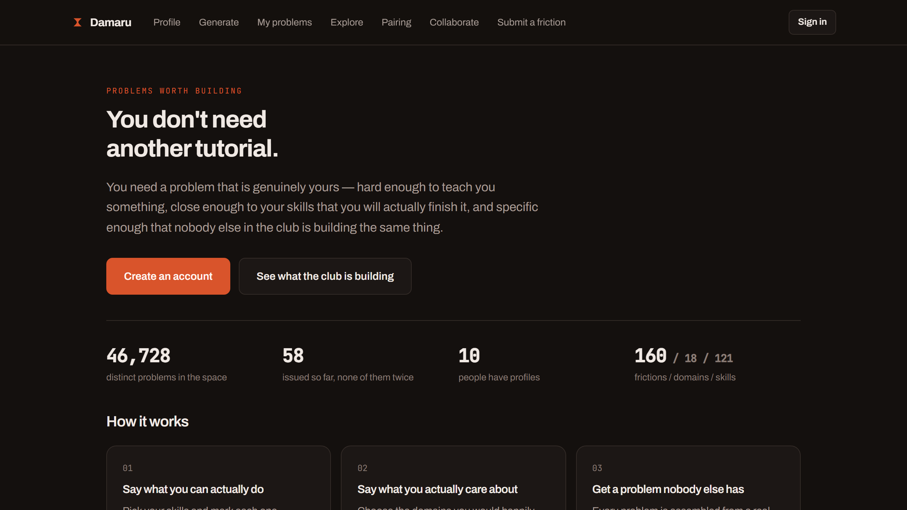
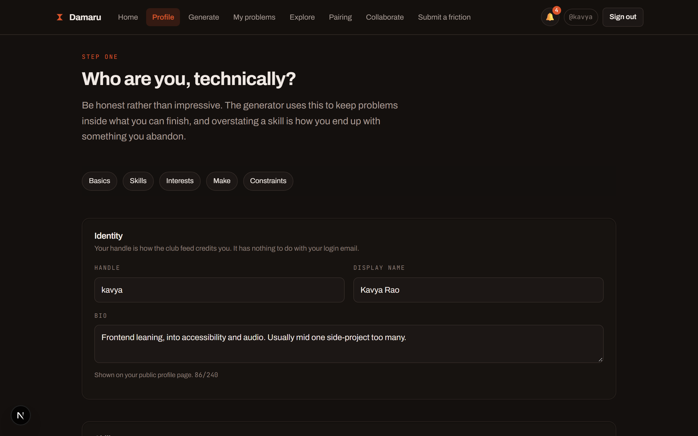
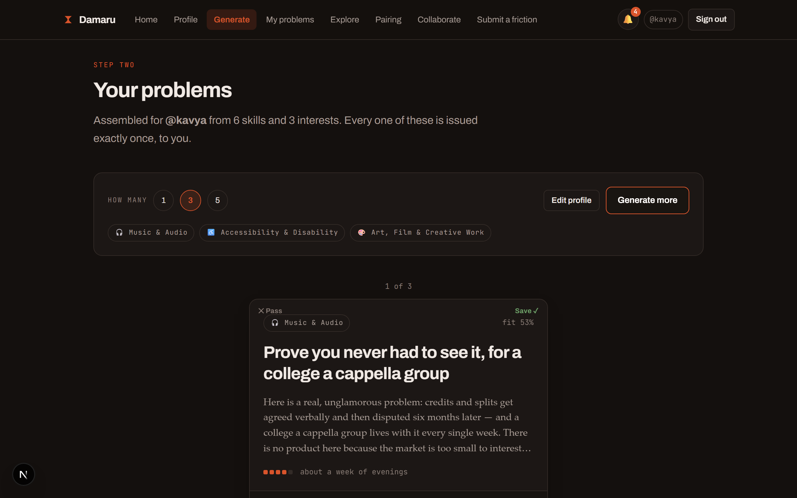
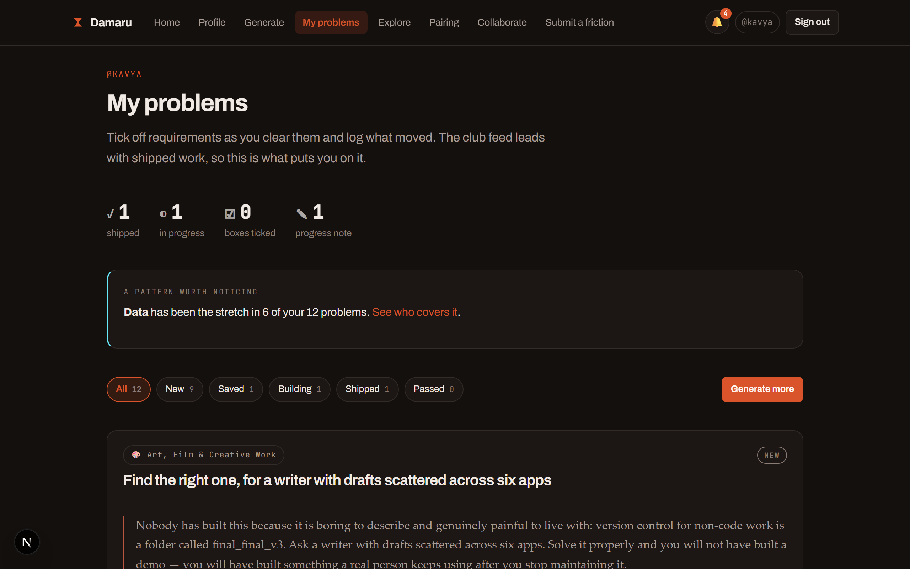
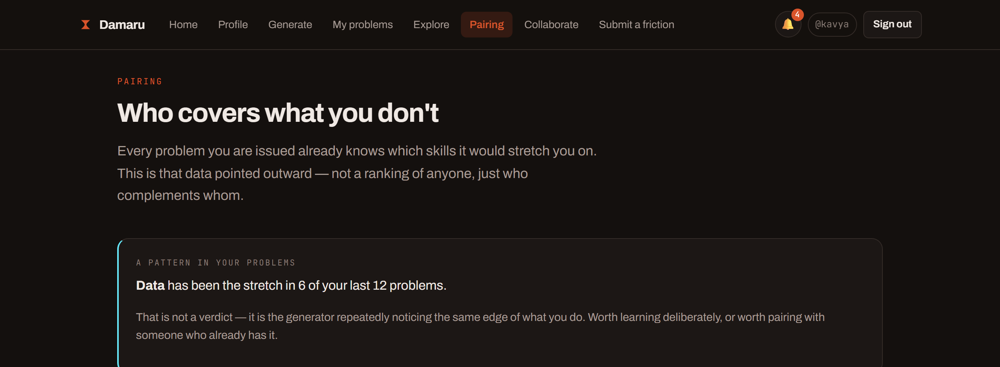
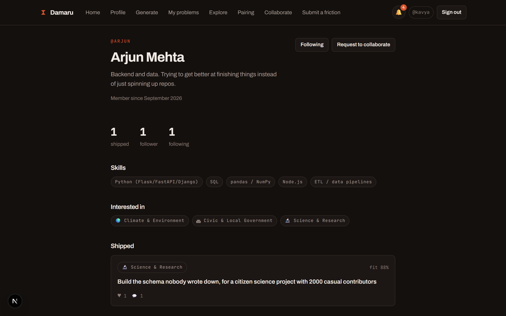
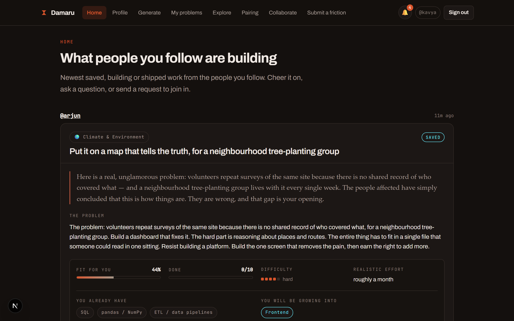
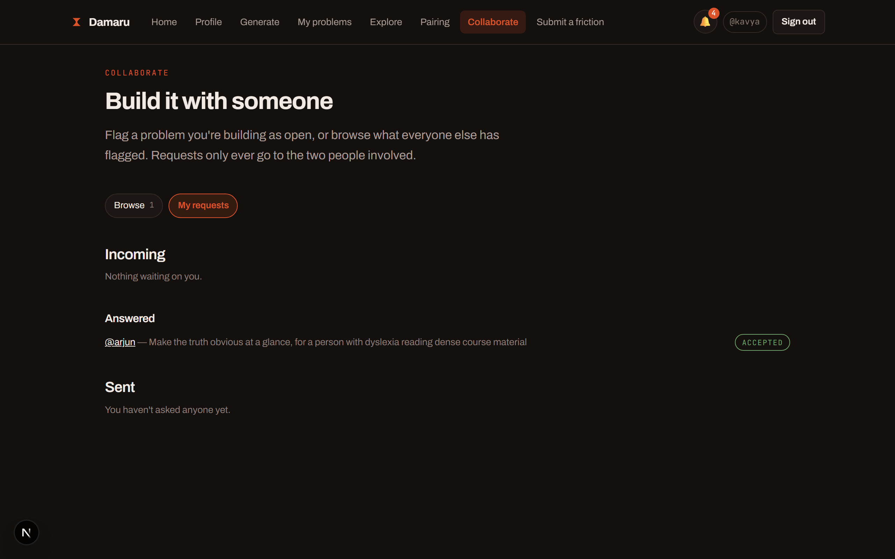
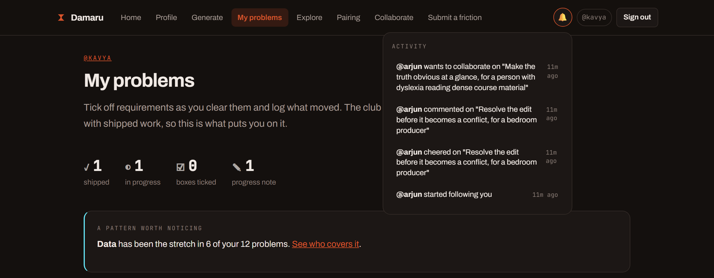

# Damaru

A website where people upload their skills and interests, and get back a project
problem statement that is **specific to them**, **doable with what they know**, and
**never issued to anyone else** — then a club around it: an activity feed of what
is actually moving, a showcase of finished work you can fork, pairing suggestions,
open roles, build logs, and a friction catalogue the members write themselves.

Next.js + TypeScript, Supabase (Postgres + auth), deployable to Vercel for free.
No LLM anywhere in it — the generator is a deterministic combinatorial engine,
which is also why it is free to run.

---

## What it looks like

The pitch, then the actual product.



Honest self-assessment first — skills marked by how comfortable you actually are, not
a wishlist:



A batch to triage, one card at a time — not a wall of text to read before deciding
anything:



Then it's yours to track: tick off requirements, log what moved, flag it as open for
someone else to join:



---

## Quick start

**1. Create a Supabase project.** [supabase.com](https://supabase.com) → New project →
wait ~2 min for it to provision.

**2. Run the schema.** In the project, left sidebar → **SQL Editor** → **New query** →
paste the entire contents of [`supabase/schema.sql`](supabase/schema.sql) → **Run**.
Then run every file in `supabase/migrations/` in numbered order, once each —
`001` through `012`. Three of them are catalogue content rather than structure
(`002b`, `006` and `012` seed 256 frictions between them); the rest are schema
deltas. A project that already has the schema runs only the migrations it has
not seen yet.

**3. Get your credentials.** **Project Settings → API**. Copy the **Project URL**, the
**anon / public** key, and the **service_role** key (click reveal).

**4. Configure the app.**

```bash
cp .env.local.example .env.local
```

Fill in the three values from step 3. `.env.local` is gitignored — it never leaves
your machine.

**5. Install and run.**

```bash
npm install
npm run dev
```

Open http://localhost:3000. Sign up, confirm the account (see [Email
confirmation](#email-confirmation) below), build a profile, generate.

Requires **Node 22.5+** (24 recommended).

---

## What it costs to run

Nothing, at club scale. There is no LLM API key — the generator is a local
combinatorial engine. Supabase's free tier (500 MB database, 50k monthly active
users, unlimited API requests) covers this comfortably; Vercel's free tier covers
the hosting. You will not hit either ceiling running this for a club.

---

## How the generator works

Most "project idea generators" stop at a noun: *build an app for music*. That
produces ideas nobody finishes, because there is no user, no crux, and no
constraint. Damaru assembles every problem from six bound parts:

| Part | What it contributes | Lives in |
|---|---|---|
| **Domain** | The area the person cares about | `catalog/domains.ts` |
| **Actor** | A specific kind of person who feels the pain | bound to each friction |
| **Friction** | A concrete, unglamorous, recurring annoyance | the `frictions` table |
| **Mechanic** | The technical crux — what's actually interesting to build | `catalog/blocks.ts` |
| **Artifact** | The shipping format: web app, CLI, bot, device, investigation | `catalog/blocks.ts` |
| **Twist** | A constraint that forces it somewhere non-obvious | `catalog/blocks.ts` |

Frictions live in Postgres; domains, mechanics, artifacts and twists stay in
code. That split is deliberate: the structural pieces change rarely, but
frictions are the thing club members write, and an accepted submission reaches
the generator immediately with no deploy. The engine itself stays a pure,
synchronous function — the catalogue is passed in by the route that loads it,
not fetched from inside `generateProblems()`.

**The parts are bound, not sampled independently.** Each friction names the actor
who feels it and the mechanics that could plausibly answer it; each mechanic names
the artifact shapes it can sensibly ship as. Sampling those freely is how a
generator ends up proposing a playable game to fix a timetable clash — coherent
grammar, nonsense content. The bindings are the difference.

The landing page counts the valid space from the live catalogue
(`combinationSpace()`), so the figure moves the moment a friction is accepted.
With the 256 seeded frictions and the catalogue as it stands — 39 mechanics,
18 artifacts, 28 twists across 18 domains — that is just over 108,000 valid
combinations, and every accepted friction adds a few hundred more.

### Variety, and why it needed fixing

The first version of this was repetitive in a way the uniqueness guarantee
hid. `fingerprint()` hashes the *DNA tuple*, so two briefs can be honestly
"never issued to anyone else" and still open with the same seven words. Across
the first 67 problems issued to real members, 78% of titles shared an opening
phrase with another, 52% said "Build a physical device", and 100% ended with
the same four success criteria. Members said it plainly: the problems were
repetitive and not that interesting to build.

The cause was **catalogue shape, not the sampler**. This club is hardware-
skewed, and `hardware` was required by exactly one mechanic against `data`'s
fourteen. A hardware-only profile had four buildable combinations out of 109,
and the gap between its best and second-best was larger than every scoring
term in the engine combined — so no amount of novelty pressure could have
moved it. Depth had to come first:

- **The catalogue grew where the skills actually are.** 30 → 39 mechanics,
  14 → 18 artifacts, 18 → 28 twists, 160 → 256 frictions. Ten of the new
  mechanics are hardware, mechanical or electrical. `Artifact.kind`
  (`software` / `physical` / `either`) lets moods and twists target by kind
  instead of enumerating ids.
- **Interests became a weighting, not a gate.** `INTEREST_SHARE = 0.6` — in-
  interest domains split 60% of the probability, everything else splits 40%,
  so roughly two briefs in three stay in-interest and the rest are a genuine
  change of scene. A *share* rather than a ratio, because a fixed 3:1 gives a
  3-interest member and a 6-interest member wildly different odds.
- **Novelty pressure, personal and club-wide.** `getDnaUsage()` tallies which
  mechanics and artifacts have been issued, and ranking penalises the
  well-worn ones — personal use weighted roughly twice club use, since
  "repetitive" is about what *one person* was handed. Deliberately smaller
  than the fit gap: novelty must never dethrone doability.
- **Appetite became a percentile** of what this person can actually reach,
  not an absolute score (see below).
- **The prose stopped being one voice.** Five title shapes, 12 hook openers,
  stake lines chosen by `artifact.kind`, and success criteria that are now
  five lines with three derived from the problem's own DNA via
  `Mechanic.proof` / `Twist.proof`.

Measured on a hardware-only profile over 60 simulated briefs: frictions drawn
4 → 36, distinct mechanics 3 → 13, "device" share 72% → 33%, distinct title
openings ~3% → 87%, and usable moods 3/5 → 5/5.

**Composed prose is frozen into `payload` at insert**, so none of this
rewrites existing problems — the 67 already issued keep their exact text, and
the improvement only shows on new draws. That is also why the database can
only ever tell you "before"; `src/scripts/audit-catalogue.ts` exists to
measure "after" (see [Measuring the catalogue](#measuring-the-catalogue)).

### Moods

`/generate` asks what you are in the mood to build before it draws. A mood
(`catalog/moods.ts`) is a **hard filter** over combinations the engine was
going to consider anyway, not a nudge — picking "something small" and being
handed a semester-long build would be a lie:

| Mood | Selects for |
|---|---|
| Something small | `artifact.weight === 1` — finishable in a weekend |
| Something hard | a genuinely difficult crux, not merely a big one |
| Something visual | frontend or design in what it needs |
| Something physical | `artifact.kind === "physical"` |
| Something to figure out | the answer is the deliverable, not the app around it |

When a mood cannot be satisfied the engine drops it and says so on the card,
the same contract as the relaxation ladder below. Every predicate reads values
the catalogue and `scoreFit` already produce — nothing new is stored, and none
of it touches the draw's randomness.

### Doability

Skills collapse into per-category strengths (`engine/fit.ts`). Each candidate is
scored on how much of what it needs the person already has:

- **≥ 0.75** in a category → *covered*
- **> 0** but below that → *stretch*
- **0** → *gap*

A candidate is rejected below **0.34 fit** or with **more than one gap** — below
that line you spend the whole project fighting tools rather than the problem.
Everything surviving is ranked by distance from the person's stated appetite,
expressed as a **percentile of their own reachable range** rather than an
absolute score:

| Appetite | Aims at |
|---|---|
| Play to my strengths | the 85th percentile of what you can reach |
| Stretch me | the 50th |
| Throw me in | the 20th |

The absolutes this replaced (0.86 / 0.68 / 0.52) assumed a spread of fit
scores that almost nobody has — real profiles cluster between 0.37 and 0.55,
so "play to my strengths" pointed above everything available and landed on
whichever single combination sat nearest the number, every time, for everyone
with similar skills. Scores are deduped before the percentile is taken, so a
mechanic offering five shipping formats cannot drag it around just by having
more rows. Below three candidates `appetiteTargetFrom()` takes the end of the
range instead: a percentile over two values is a coin flip dressed as a model.

Difficulty and the effort estimate are computed **relative to this person**, not in
the abstract — the same problem is a weekend for one profile and a term for another.

### When nothing clears the bar

A narrow profile can have an *empty* intersection between "mechanics these
frictions allow" and "mechanics this person can build" — four hardware skills
against two software-shaped interests, for instance. Returning nothing there is
the wrong answer, so `RELAXATIONS` in `engine/index.ts` lowers the bar a step at a
time and says so on the card:

| Tier | Bar | Card shows |
|---|---|---|
| 1 | fit ≥ 0.34, ≤ 1 gap | nothing — normal result |
| 2 | fit ≥ 0.24, ≤ 2 gaps | "bigger stretch than you asked for" |
| 3 | fit ≥ 0.12, ≤ 3 gaps | "well outside both your interests and your skills" |

The tiers now vary only the bar. There used to be a fourth that kept the bar
and widened to all domains, which stopped meaning anything once interests
became a weighting rather than a gate — an out-of-interest draw is routine, so
it should not apologise for itself.

It stops at the strictest tier that fills the request, so a well-matched profile
never sees a caveat. An empty page is now only possible when every combination
that fits has already been issued — which the error message says explicitly.

### Uniqueness

Every problem's DNA hashes to a 64-bit `fingerprint`, which is `UNIQUE` in
Postgres. Generation excludes every fingerprint ever issued to anyone, and the
unique constraint is the final arbiter if two requests race. No two people in the
club can ever be handed the same problem.

Note what the guarantee does *and does not* cover: it is over the DNA tuple,
not the prose. That is the right unit — two people should never be handed the
same *problem* — but it is why variety had to be fixed separately, in the
catalogue and the composer, rather than assumed from the fingerprint.

### Rerolling

A card you have not decided on yet can be swapped for a fresh draw in the same
domain (`POST /api/problems/[id]/reroll`). This is "I don't want this specific
execution", not a decision, so the old problem is deleted and its fingerprint
goes back into the pool rather than staying reserved forever. Only `new`
problems can be rerolled — once you have saved or passed on something, you
have decided.

It pins the domain through a real `restrictDomains` option on the engine.
(It used to fake this by passing `{ ...profile, interests: [domainId] }`,
which worked only while interests were a hard filter and broke silently the
moment they became a weighting.)

### Measuring the catalogue

`src/scripts/audit-catalogue.ts` runs the real engine against four synthetic
skill archetypes — hardware-only, hardware + mechanical, software, mixed — and
gates on what the generator actually produces: per-category unlock counts,
buildable combinations, mood feasibility, twist pool per artifact, friction
and mechanic coverage, and prose lints over a 60-brief simulated draw (title
variety, no dominant opening, artifact spread).

```bash
node --import ./src/scripts/register-alias.mjs src/scripts/audit-catalogue.ts
```

No build step and no dependencies. Node strips the TypeScript itself (run on
24; on versions before 23.6 add `--experimental-strip-types`), and the two
`.mjs` files beside it are a small ESM resolve hook so plain `node`
understands the app's `@/` import alias without any app code changing to suit
the script. The static sections need nothing; if `.env.local` is present it
also pulls the live friction catalogue and simulates real draws. It sets a
non-zero exit code when a gate fails, so it works as a pre-commit check on
catalogue edits.

This exists because stored prose is frozen: the database can only ever report
on briefs written by the old composer, so simulation is the only honest source
of "after" numbers.

### Measuring what happens next

The audit measures what the generator *can* produce. `/admin/funnel` measures
what people then did with it — the question that actually decides whether any
of the rest is worth building:

```
Generated → Triaged → Committed → Shipped
```

Plus, separately: how many committed projects ever got a build log (an
orthogonal fact, not a stage — a project can be marked shipped without one),
whether stalled projects are measurably bigger than finished ones, the effort
mix across everything issued, who came back on a second day, and which
mechanics and artifacts were really handed out rather than simulated.

`lib/funnel.ts` is a pure function over plain rows, in the same spirit as
`activity-feed.ts`, so every number has exactly one definition and the page
and the CLI cannot disagree. The CLI is:

```bash
node --import ./src/scripts/register-alias.mjs src/scripts/funnel-report.ts
```

Admin-gated despite containing no private data, because it is per-member
outcomes — "who in the club has finished nothing" is not something the club
should be able to browse. Same reasoning as `pairing.ts` refusing to produce
a sortable score.

---

## Auth and data access

Identity is Supabase Auth (email + password) — `profiles.id` **is** the
`auth.users.id`, so a profile can only ever belong to the account that owns it.
`handle` is a separate, user-chosen public display name shown on the club feed; it
has nothing to do with login and carries no authorization weight.

The server is the trusted gatekeeper, the same architecture as before the
migration: every route that touches data calls `getCurrentUser()` and checks
ownership itself (`src/lib/db.ts` talks to Postgres through the **service-role**
key, which bypasses Row Level Security entirely). RLS policies in
`supabase/schema.sql` exist as defense in depth — if the anon key ever reached
Postgres directly, they are what stop it reading or writing someone else's data —
not as the primary enforcement.

**The one thing genuinely worth knowing:** `PATCH /api/problems/[id]` didn't check
ownership at all in the pre-Supabase version — anyone who knew or guessed a
problem's UUID could edit its status and notes. That's fixed as part of this
migration (`src/app/api/problems/[id]/route.ts` now checks `problem.profileId ===
user.id`), but call it out if you're diffing.

### Email confirmation

Supabase requires a clicked confirmation link before a new account gets a session,
by default. The signup flow handles this (`src/app/auth/actions.ts` checks whether
`signUp` returned a session and redirects to a "check your email" notice if not),
but for a club tool the friction may not be worth it. To turn it off: **Authentication
→ Providers → Email → uncheck "Confirm email"**. Either way works with no code
change.

---

## Pairing

Every problem the generator issues already knows which skill categories it would
stretch the person on — `fit.ts` computes it to render one chip and then throws
it away. `/pair` points that data outward: who covers what you don't, and what
you cover for them.



Two rules the implementation holds to, because this is the feature that can land
badly socially:

- **Complement, never ranking.** `findComplements()` has no notion of a stronger
  or weaker member and produces no score you could sort people by. The unit is
  always a pair, and mutual pairs sort above one-way ones — which are labelled
  as favours rather than quietly mixed in.
- **Being listed is the person's own call.** `profiles.discoverable` defaults on
  but is toggleable from the profile page or `/pair`. Only a handle and skill
  categories are ever exposed; profiles hold no email.

The dashboard also surfaces a recurring-gap note ("design has been the stretch in
4 of your 6 problems"). It is drawn from problems already issued, and stays
silent until a category has appeared more than once.

The same page also has a **"Browse by expertise"** directory — every discoverable
member, filterable by skill category, each with an inline "request to collaborate"
composer. This is where a *general* collaboration request (not tied to any specific
problem) comes from; see the next section.

---

## Follow, a home feed, and collaborating

The pieces above (profiles, pairing, problems) exist independently of each other by
design — but the club is made of people, not just a catalogue, so there is a thin
social layer stitched across all of it: follow people, get a feed of what they're
building, react to it, and ask to join in.

### Public profiles, following, likes and comments

Every member has a public page at `/u/[handle]` — bio, skills, interests, and their
**shipped** work, each with like and comment counts. Following someone is one button;
follower/following counts are public the same way the club feed already is.



A problem is treated like a post: anyone signed in can like it (♥) or leave a
comment, from the dashboard, the feed, or Explore. `Engagement.tsx` is the one
component that owns this everywhere it appears — optimistic like toggling, lazy-loaded
comment thread, nothing else needs to know how either works.

### The home feed

`/home` is the default landing page after signing in, and it is the room the
club is building in rather than a list of your own things. Seven sections, in
this order:

| Section | What it is |
|---|---|
| Right now | everything that has actually moved, newest first |
| Building right now | actively worked on — the build log is the evidence |
| From people you follow | the same stream, filtered to who you follow |
| Looking for help | someone is stuck on something you might know |
| Looking for teammates | published roles waiting on someone |
| Projects matching you | scored against *your* skills, not their owner's |
| 🚀 Just shipped | finished, in someone's hands, done |

The stream behind the first three is `lib/activity-feed.ts`, which merges
events out of records that already exist — projects, build logs, status
transitions, roles, team joins — rather than a parallel event log. Seven event
kinds, each keyed `${kind}:${sourceRowId}` so ids cannot collide across the
five source tables.

**Likes and comments are deliberately absent from the ranking.** "Meaningful
progress outranks popularity" is easiest to guarantee by never putting
popularity in the ordering at all; engagement appears as a demoted count on a
card instead. An account that follows nobody still sees a full page — the
follow-filtered section is the only one that empties.

"Projects matching you" comes from `lib/match.ts`: the same catalogue lookup
and `scoreFit` the fork route already does, re-scored for whoever is looking,
because the stored `problem.fit` was scored against the owner at generation
time and means nothing to anyone else. Deterministic and local — no model, no
API call, no randomness.



### Discover, and the Showcase

Two public pages that answer different questions.

**`/discover`** — "what is worth my attention?" Filter the whole club feed by
domain or by skill, with URL-backed filter state so a filtered view is a
link you can send someone. Two things sit above the list:

- **Project Radar** — what is moving this week. Binary tiers, not a blended
  score: a build-log entry (real movement) always outranks likes and comments
  (people noticing), and count is only ever a same-tier tiebreak. Same spirit
  as `pairing.ts` — complement, not ranking.
- **The Weekly Digest** — a short, honest summary of the last seven days.

The skill filter reads what a project *needs*, from its mechanic and artifact
`requires` — not from `problem.fit.covered/gaps`, which are relative to
whoever it was issued to and would make the filter wrong for everyone else.

**`/showcase`** — "what did people actually finish?" Shipped work only, newest
first, as cover cards. This is the page that makes finishing visible, and it
is where forking starts.

### Forking

Open someone's shipped project and you can start your own version of it. The
fork pins the source's exact DNA — so it reads as the same brief, and the
lineage is recorded in `problems.inspired_by_problem_id` — but **re-scores fit
for whoever is forking it**, which is the honest part: the same build is a
different amount of work for a different person.

The lineage column is `on delete set null`, not cascade. A fork is its own
independent project, not a row owned by its source, so it survives the source
being deleted and merely loses the backlink. The original's owner is notified
when their work is forked.

### Collaboration requests

Two ways to end up building something with someone else, sharing one
`collab_requests` table (a nullable `problem_id`, and a nullable `role_id` once
a project has published roles, are the only difference):

- **Flag a specific problem.** From the dashboard, mark an in-progress problem
  "open to collaborators." It shows up on `/collaborate`'s Browse tab for
  everyone else, next to what skill categories it could use a hand with (the same
  `fit.gaps`/`fit.stretch` data the problem already carries).
- **A general request.** Found someone through the pairing directory or their
  profile page whose skills you want, but not around a specific problem? Send them
  a request directly.

Either way, the request goes to exactly one person, who accepts or declines from
`/collaborate`'s "My requests" tab — never a public thread, never CC'd to anyone
else. Accepting a request tied to a problem does one more thing now: it adds the
requester to that project's team. See the next section.



### Projects: a real ladder, teams, open roles, and a build log

A problem stops being just a generated brief the moment someone commits to it.
`ProjectStatus` (`src/lib/status.ts`) is the real pipeline every project moves
through:

```
new → idea → prototype → building → beta → shipped   (+ passed, from anywhere)
```

`new` is the generator's raw output, before anyone has decided anything — the
spark. Everything from `idea` on is a project: it can have a **team** beyond
its single creator (`project_members`), the owner can **publish open roles**
people apply to (`project_roles` — name, skills, seats needed, commitment,
duration; applying rides the exact same `collab_requests` accept/decline flow
above, just with `role_id` set), and it gets a **typed build log** instead of
a plain-text progress note: 🟢 progress, 🔴 blocked, 🟡 looking for help, 🎉
milestone, 🚀 shipped, each optionally carrying a link or an image URL
(`progress_entries.kind`/`image_url`/`link_url` — both URLs are validated as
plain `https?://` links both in the database and in the API route, since they
render as `<a href>`/``).

Every project also gets a real, shareable page at **`/p/[id]`** — public, so a
link works signed out — composing the existing `<ProblemCard>` with three new
pieces: `<TeamSection>`, `<OpenRoles>`, and `<BuildLog density="full">`. Every
place a problem already appeared in a list (the dashboard, the home feed,
Explore, a profile's shipped grid, a collaboration card) now links its title
straight there.

A seat filling is checked twice — once when someone applies, once again right
before the owner accepts — since two people can apply to the same one-seat
role before either is answered.

### Notifications

A bell in the nav with an unread badge: new follower, someone liked or commented on
your problem, a collaboration request came in or got accepted. It polls quietly every
45 seconds and marks everything read the moment the dropdown opens.



---

## Contributing frictions

The catalogue is the quality lever. Every friction that shipped originally was
written by one person guessing at what annoys people; the ones worth building
against are the ones somebody has actually lived with.

- **`/submit`** — any signed-in member proposes one: a domain, who feels it, what
  is broken, and which mechanics could plausibly answer it. The form teaches the
  bar inline, because a vague friction is worse than none.
- **`/admin/frictions`** — the review queue. Accepting puts it in the generator
  immediately.

One convention learned the hard way: **a physical friction should name two to
four mechanics, not one.** Every physical friction in the original seed named
exactly one, against an average of 4.04 for the rest, which left the sampler
with no choice to make and was a direct cause of the repetition. A mechanic no
friction names at all is simply invisible — `offline-sync` was undrawable from
the day it was written, and nothing surfaced that until the audit script went
looking.

Admin is set in the database and nowhere else:

```sql
update profiles set is_admin = true where handle = 'your-handle';
```

`is_admin` is deliberately absent from the profile upsert's column list, so it
survives profile edits and cannot be granted through the API.

---

## Triage and feedback

A freshly generated batch is 3-5 problems, each several screens long once
expanded. Reading all of them in full before deciding on any is the wrong
default, so `/generate` hands a batch to `<SwipeTriage>` instead of a flat list:
a compact card (title, hook, fit%), decided by drag, tap, or the arrow keys,
with an explicit "read the full brief" escape hatch before committing — nobody
should be swiping blind on something they might spend weeks building.

Swiping does not invent new state. It writes the same `idea` / `passed`
statuses the dashboard already understands, just with a faster gesture for the
one moment - right after generation - where that's the only decision that
matters.

Each `ProblemCard` also carries a 👍/👎: not a rating of the person, a signal on
whether *this friction* actually produced a good problem for them. That only
means something once it can be traced back to where it came from, so
`ProblemDNA.frictionId` links every problem to the specific catalogue row it
was drawn from - added at generation time in `engine/index.ts`, not
reconstructed later by matching text. `/admin/frictions` rolls the tally up
per friction on the accepted tab, so a friction that is quietly producing bad
matches is visible rather than assumed.

---

## Deploying to Vercel

1. Push this repo to GitHub (already done if you're reading this from the repo).
2. [vercel.com](https://vercel.com) → **New Project** → import the repo.
3. Add the same three environment variables from `.env.local` in the Vercel
   project's **Settings → Environment Variables**.
4. Deploy.

Vercel detects Next.js automatically, and there is no filesystem dependency
left (that was the whole reason for this migration: the SQLite version could
not run on Vercel's read-only, ephemeral filesystem at all).

### Put the functions next to the database

`vercel.json` pins the function region, and it is the single highest-impact
line in this repo:

```json
{ "regions": ["icn1"] }
```

**`icn1` is Seoul because the Supabase project is in `ap-northeast-2`, which
is Seoul.** If you move the database, move this with it, or the site gets
slow in a way that looks like a code problem and is not.

The reasoning, measured rather than assumed. Vercel defaults new projects to
`iad1` (Washington). With the database in Seoul, that put an ocean between
the two, and `x-envoy-upstream-service-time` showed the database answering
in **3ms** while a round trip to it cost about **700ms**:

| hop | cost |
|---|---|
| member → nearest Vercel edge | ~93ms |
| edge → function | ~10ms |
| **function → Supabase and back** | **~700ms** |

So a page costs roughly "number of times it asks the database" × 700ms,
and `/discover` — which asked seven times in a row — took 4.0 seconds.

Seoul rather than Mumbai, despite every member being in India, because a
page makes **one** round trip to the member and **several** to the database.
Co-locating with the data wins: one extra ~100ms hop over Vercel's backbone
buys you ~2ms database calls instead of ~120ms ones.

The genuinely ideal setup is both in Mumbai — database in `ap-south-1`,
functions in `bom1` — which removes the remaining hop as well. That needs a
Supabase project migration (dump, restore, new URL and keys), so it is a
deliberate move rather than a config change.

### Why the pages are shaped the way they are

Because a round trip is ~200x the cost of the query, server components here
are written as **two waves at most**: everything that does not depend on
another call's *output* goes in one `Promise.all`. `/home` and `/discover`
both read that way on purpose, and `buildActivityFeed`'s `since` option
exists so a caller can ask the database once for all history and try two
different windows against the same rows in memory. If you add a sequential
`await` to a page, you are adding most of a second to it.

---

## Project structure

```
supabase/
  schema.sql             tables, constraints, RLS policies - run once per project
  migrations/            numbered deltas, 001-012, run in order once each
                           002b / 006 / 012 are catalogue content, not structure
docs/
  screenshots/            images used in this README
src/
  middleware.ts           refreshes the Supabase session cookie on every request
  scripts/
    audit-catalogue.ts     measures whether the generator produces varied,
                             buildable briefs - gates on coverage + prose lints
    funnel-report.ts        the admin funnel page, in the terminal
    alias-hooks.mjs         ESM resolve hook so plain `node` understands `@/`
    register-alias.mjs       the --import entry point that installs it
  app/
    layout.tsx             fonts, nav, and the pre-paint theme script
    page.tsx               landing
    login/, signup/         auth pages
    auth/actions.ts         server actions: login, signup, logout
    (app)/                  auth-gated route group
      layout.tsx             redirects to /login if no session
      home/                    the club's activity feed - default landing signed in
      profile/                skills, interests, constraints
      generate/                draw new problems, optionally in a mood
      dashboard/               your problems + status + notes
      pair/                     who complements you + browse by expertise
      collaborate/              browse problems open to collaborators + your requests
      submit/                    propose a friction
      admin/frictions/            review queue (is_admin only)
      admin/funnel/                what happens after a brief is issued (is_admin only)
    browse/                 public "Explore" club feed (no auth required)
    discover/               public: filter by domain/skill + radar + weekly digest
    showcase/               public: shipped work only, as cover cards
    u/[handle]/             public profile page - follow, shipped work, request to collaborate
    p/[id]/                 a project's own page - team, open roles, build log (public)
    api/
      me/                    GET current session's user + profile
      profile/               GET / POST (session-scoped)
      generate/               POST { count, mood? } (session-scoped)
      problems/                GET (your problems + projects you joined, session-scoped)
      problems/[id]/            PATCH { status, notes, checklist, feedback, lookingForCollaborators }
      problems/[id]/reroll/      POST swap an undecided card for a fresh draw, same domain
      problems/[id]/fork/         POST start your own version of someone's shipped project
      problems/[id]/progress/      POST one build-log entry { body, kind, imageUrl?, linkUrl? }
      problems/[id]/like/           POST toggle a like
      problems/[id]/comments/       GET / POST comments (GET is public)
      problems/[id]/collab-requests/  POST request to join a flagged-open problem or a role
      problems/[id]/roles/          GET (public) / POST publish an open role - owner-only
      problems/[id]/roles/[roleId]/  PATCH edit or close / DELETE - owner-only
      problems/[id]/members/[profileId]/  DELETE - owner removes anyone, a member removes themselves
      profiles/[handle]/         GET public profile bundle (shipped work, follower counts)
      profiles/[handle]/follow/   POST / DELETE
      profiles/[handle]/collab-requests/  POST a general (non-problem) request
      collab-requests/            GET incoming + outgoing, split by direction
      collab-requests/[id]/        PATCH { status } - recipient-only, adds team membership on accept
      collaborate/               GET problems flagged open to collaborators
      directory/                 GET discoverable members, filterable by strong category
      notifications/              GET recent + unread count
      notifications/read/          POST mark everything read
      frictions/                GET/POST your own submissions
      admin/frictions/           GET review queue + feedback tally (is_admin only)
      admin/frictions/[id]/       PATCH accept/reject
      admin/funnel/              GET the generated -> shipped funnel (is_admin only)
      pair/                    GET complements + recurring gap
      stats/                  GET counts
  components/
    Nav.tsx                  top nav + auth state + notification bell + theme switch
    ThemeToggle.tsx           light/dark switch; the attribute is the whole mechanism
    ProblemCard.tsx           the full problem view - checklist, build log, engagement bar
    ProjectCard.tsx            the compact list form, used by home/discover/collaborate
    ShowcaseCard.tsx            the cover-card form, shipped work only
    ActivityFeed.tsx           renders the merged club activity stream
    DiscoverExplorer.tsx        Discover's filters + radar, URL-backed
    WeeklyDigest.tsx             the last seven days, summarised
    FunnelReport.tsx              draws the funnel; takes a report, decides nothing
    BuildLog.tsx               typed build-log timeline + composer, two densities
    TeamSection.tsx             a project's team list, owner-managed
    OpenRoles.tsx               published roles + apply flow + the owner's publish form
    Engagement.tsx             the like button + comment thread, shared by every problem view
    NotificationBell.tsx        unread badge + dropdown, polls every 45s
    SwipeTriage.tsx          drag/tap/arrow-key triage for a freshly generated batch
    AuthPitch.tsx / AuthToggle.tsx / SubmitButton.tsx   auth page furniture
    DamaruSpinner.tsx         the loading indicator - an actual damaru being played
    Mark.tsx                 the wordmark, reused as the spinner's body
  lib/
    types.ts                shared domain types
    status.ts                 the project status ladder + build-log kinds - single source of truth
    db.ts                   Postgres data access via the service-role client
    activity.ts              staleness + checklist progress (shared client/server)
    activity-feed.ts          merges five source tables into one ranked event stream
    discover.ts               Discover's skill filter + Project Radar tiers
    funnel.ts                 generated -> shipped outcomes, as a pure function
    match.ts                  "projects you might want in on", scored for the viewer
    pairing.ts                complement + recurring-gap logic
    client.ts                 tiny fetch wrapper client components use to call the API
    supabase/
      server.ts               session-aware client (reads cookies, respects RLS)
      admin.ts                 service-role client (bypasses RLS - server only)
      browser.ts                browser client
      types.ts                  hand-written Database type for supabase-js
    catalog/
      skills.ts               121 skills across 19 categories (11 software, 8 non-software engineering)
      domains.ts               18 domains (frictions live in Postgres)
      blocks.ts                 39 mechanics, 18 artifacts, 28 twists
      moods.ts                   what you're in the mood to build, as a hard filter
    engine/
      index.ts                candidate selection  <- the LLM seam
      fit.ts                   doability scoring + percentile appetite
      compose.ts                 prose composition: title shapes, hooks, success criteria
      novelty.ts                  fingerprinting + seeded RNG + weighted picking
```

---

## Extending it

Nearly all the quality lives in the catalogue, not the code.

**Add a friction** — use `/submit` in the app. They live in the database now, so
no code change or deploy is involved.

**Add a domain** — append to `DOMAINS` in `catalog/domains.ts` (id, label, icon,
signals). Frictions then get attached to it through `/submit`.

**Add a mechanic** — append to `MECHANICS` in `catalog/blocks.ts`, list the
`artifacts` it can ship as, the skill categories it `requires`, its `proof`
(what shows the crux actually holds — this becomes a success criterion), and
add a handful of short imperative variants to `MECHANIC_ACTIONS` in
`engine/compose.ts`. **Then write frictions that name it**, or it is
unreachable: the generator only ever sees a mechanic through a friction that
lists it.

**Add a twist** — append to `TWISTS`, with a `proof` and optionally an
`appliesTo` kind so a software-only constraint never lands on a physical
build. This is the cheapest way to multiply the space: each new twist
multiplies every existing combination.

**Never rename or remove a catalogue id.** Stored problems reference mechanic,
artifact and twist ids in their frozen DNA, so a removed id turns into an
undefined lookup in the fork route and in `match.ts`. Adding is always safe;
renaming never is.

**Run the audit after catalogue edits** — `node --import
./src/scripts/register-alias.mjs src/scripts/audit-catalogue.ts`. It is the
difference between believing the catalogue is balanced and knowing it.

Writing frictions is the real work. The test is whether a specific person would
read it and wince. "Data is siloed" fails. "Their sample library is four thousand
unlabelled WAV files and finding the right kick means auditioning for an hour"
passes.

### Theming

Two themes, light by default, switched by `data-theme="dark"` on `<html>` and
nothing else. Everything below the token block in `globals.css` reads CSS
variables and never a raw colour — which is what made adding a second theme a
palette rather than a rewrite, and is worth preserving: a hardcoded hex in a
rule is a bug in one theme by construction.

The remembered choice is applied by a small blocking inline script in
`layout.tsx` before first paint, because doing it in an effect shows everyone
who chose dark a white page first and then flips it. `ThemeToggle` suppresses
CSS transitions for two frames across the swap so the change is instant
rather than a ragged crossfade.

Light is the default even when the operating system prefers dark. That is
deliberate rather than an oversight — the dark palette was the only one for a
while and members read it as intimidating, so a first visit should not start
there. Every colour token clears WCAG AA (4.5:1) against the darkest surface
it is used on.

### Swapping in an LLM later

`generateProblems()` in `src/lib/engine/index.ts` is the only seam. Everything
downstream consumes `GeneratedProblem[]`, so a model-backed implementation is a
one-file change — keep `fit.ts` for scoring and `novelty.ts` for the uniqueness
guarantee, and let the model do composition. Not needed today; the offline engine
is the product.

---

## Known limitations

**The service-role key is powerful.** It bypasses every RLS policy in the
database. It lives only in `.env.local` (local) and Vercel's environment variable
store (production) via `server-only`-guarded modules — never commit it, never put
it in a client component, never paste it anywhere but an env var.

**Rejecting a submission is silent.** The submitter sees the state change on
`/submit`, but nothing tells them why. For a club where you can just talk to the
person, that is probably right; it would not be on a larger tool.

**Changing the schema means updating two places.** `supabase/schema.sql` (the
actual database) and `src/lib/supabase/types.ts` (the hand-written TypeScript
`Database` type supabase-js needs to type-check inserts and updates) have to stay
in sync manually — there is no code generation step wired up.

**Notifications poll, they don't push.** `NotificationBell` checks every 45 seconds
and on mount - simple, and fine at club scale, but a new follower or comment can take
up to that long to show up in the badge without a page reload. No websocket or
Supabase Realtime subscription wired up for it.

**Problems issued before the generator overhaul keep their old prose.** The
composed text is frozen into each row's `payload` at insert, which is what
makes existing projects stable, but it also means the first 67 briefs still
read the way members complained about. Regenerating them is not possible
without breaking the "never issued twice" guarantee, so they stay as they are
and only new draws benefit.

**Some disciplines are still thin.** Aerospace, chemical and civil have far
fewer mechanics and frictions than hardware or data. That follows from where
the club's skills actually are rather than from an attempt at parity, and the
audit script reports the shortfall rather than hiding it — but somebody with
only civil skills will see a narrower catalogue than somebody with Arduino.

**Two pieces of dead code.** `GET /api/home` is unreferenced since `/home`
became a server component, and `appetiteTarget()` in `engine/fit.ts` is
superseded by `appetiteTargetFrom()`. Both still compile and both should go.

**`prefers-color-scheme` is ignored until you press the switch once.** A
deliberate trade (see [Theming](#theming)), but it does mean a dark-mode user
gets a light page on first visit.
